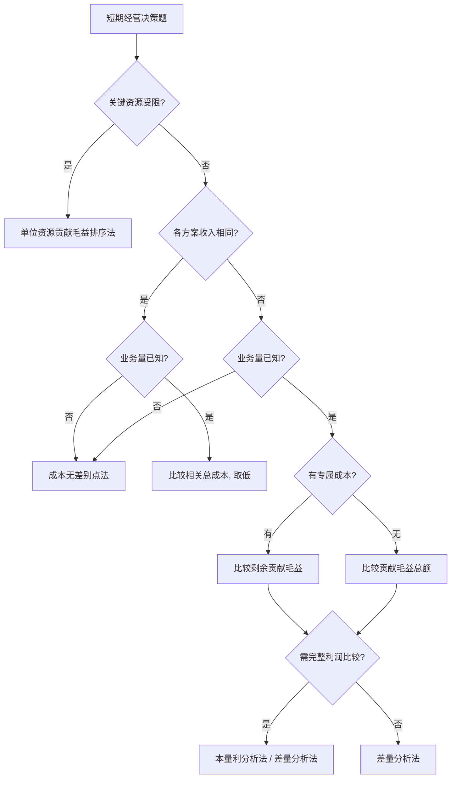

# 管理会计短期经营决策 Skill

> 把一个"管理会计期末案例题"变成**可逐行验算**的决策报告：识别题型 → 判定相关成本 → 选对方法 → 分步计算 → 给结论。

[](LICENSE)
[](CHANGELOG.md)
[](#)
[](#)
[](https://github.com/ZomHarry/short-term-decision-skill/releases)

## 这是什么

一个面向**短期经营决策**（一年以内、不改变经营规模）的 AI Skill / 提示词包。它解决的不是"公式记不住"，而是学生在案例题里最常翻车的一步——**该用哪个方法、哪些成本算相关**。

覆盖七类题型：自制外购、特殊订货、亏损产品去留、半成品进一步加工、生产工艺选择、最优生产批量、资源受限下的品种组合。

## 它做对了什么

| 常见做法 | 本 Skill 的做法 |
| --- | --- |
| 拿到题直接套公式 | 先走五步路由树，方法错则全盘错 |
| 把账面亏损当作停产依据 | 先算**剩余贡献毛益**，再看有无更好用途 |
| 用完全成本判断特殊订单 | 只用**相关成本**（变动成本＋专属＋机会成本） |
| 深加工把联合成本计入 | 明确联合成本是**沉没成本**，直接剔除 |
| 资源受限比单位贡献毛益 | 比**单位资源贡献毛益**（÷资源消耗定额） |
| 数据缺失时脑补一个数 | 列**信息缺口**并追问，缺关键数据不出结论 |

## 快速开始

**方式零：下载现成的 Skill 包**

到 [Releases](https://github.com/ZomHarry/short-term-decision-skill/releases) 下载 `short-term-decision-vX.Y.Z.zip`，解压到自己的 skills 目录即可。包内 `SKILL.md` 位于根目录，frontmatter 完整。

**方式一：直接当系统提示词用**

把 `prompts/system-prompt.md` 整段粘进天工／Dify／Claude／GPT 的 System Prompt，再把 `knowledge/` 下的三个文件作为知识库上传即可。

**方式二：当作 Agent Skill**

把仓库放进你的 skills 目录（如 `~/.skills/short-term-decision/`），入口是 `SKILL.md`，其 frontmatter 的 `triggers` 会按关键词命中。

**方式三：人工对照用**

做作业时直接查 `knowledge/method-decision-tree.md`（判断表）与 `knowledge/common-errors.md`（易错点）。

## 方法路由（一张图）



## 目录结构

```
short-term-decision-skill/
├── SKILL.md                      # Skill 入口：角色、边界、路由树、输出格式、自检
├── prompts/
│   ├── system-prompt.md          # 可直接投喂的完整系统提示词
│   ├── few-shot.md               # 两个完整示例（含信息缺失追问）
│   └── output-template.md        # 七段输出模板 + 自检清单
├── knowledge/
│   ├── formulas.md               # 全部公式、符号说明、口径差异清单
│   ├── method-decision-tree.md   # 决策树展开为逐条判断表
│   └── common-errors.md          # 12 条易错点（表现／错因／纠正／依据）
├── tests/
│   └── test-cases.md             # 6 道回归测试题（题目／路由／陷阱／答案要点）
├── docs/
│   ├── 教材来源与页码对照.md      # 每个公式、每条规则出自哪一页
│   ├── 原始交付说明.md            # 第一版交付说明
│   ├── 交付总览.md                # 三块产出合并版（便于一次性投喂）
│   └── assets/social-preview.png  # 社交预览图（1280×640）
├── scripts/
│   ├── build-skill-zip.ps1        # 打包成可安装的 Skill
│   └── check-repo.ps1             # 结构自检（CI 同款）
├── .github/
│   ├── workflows/ci.yml           # push / PR：自检 + 试打包
│   ├── workflows/release.yml      # 打 tag：自动发布 Release
│   └── ISSUE_TEMPLATE/            # 纠错与建议模板
├── CONTRIBUTING.md
├── CHANGELOG.md
├── LICENSE
└── README.md
```

## 输出格式（七段固定）

`题型识别 → 已知信息 → 相关成本识别 → 计算 → 结论 → 易错点 → 信息缺口`

七段缺一即视为不合格。见 `prompts/output-template.md`。

## 打包成可安装的 Skill

Skill 包的标准形态是一个 zip：解压后是**一个与技能同名的目录**，目录里 `SKILL.md` 位于根，带 YAML frontmatter（`name` + `description`），其余文件由 `SKILL.md` 引用。

```powershell
# Windows
powershell -NoProfile -ExecutionPolicy Bypass -File scripts/build-skill-zip.ps1 -Version 1.1.1

# macOS / Linux
cd .. && zip -r short-term-decision-v1.1.1.zip short-term-decision-skill -x "*/dist/*" "*/.git/*"
```

产物：`dist/short-term-decision-v1.1.1.zip`，14 个文件约 47 KB，包内结构：

```
short-term-decision/
├── SKILL.md          ← 入口，frontmatter 决定何时被触发
├── knowledge/
├── prompts/
├── tests/
├── docs/
├── README.md
└── LICENSE
```

**发布（自动）**：打 tag 并推送，Actions 会自检、打包、建 Release 并挂上附件：

```bash
git tag v1.1.1
git push origin v1.1.1
```

**发布（手动）**：Releases → Draft a new release → 选或建 tag → 把 `dist/*.zip` 拖进附件区 → Publish。

仓库里不存二进制文件（`dist/` 已 gitignore），下载统一走 Release。

> 注意：脚本文件必须以 **UTF-8 with BOM** 保存，否则 Windows PowerShell 5.1 会按 ANSI 解码中文导致语法错误。

## 测试用例

`tests/test-cases.md` 含 6 题，覆盖：资源受限选择、自制外购（业务量未知）、亏损产品有转产机会、特殊订货利用闲置产能、半成品深加工（联合成本干扰）、信息缺失。每题的"预期路由方法"可用于验证模型是否走对路径，而不只是答案对不对。

## 内容来源

公式与判断规则均整理自管理会计课程讲义（成本性态、本量利、生产经营决策、标准成本、预算），**逐条标注页码**，见 [教材来源与页码对照](docs/教材来源与页码对照.md)。凡讲义表述有歧义处，文件内均标注"需与教材核对"，不强作统一。

## 许可证与声明

本仓库采用 [**CC BY-NC-SA 4.0**](LICENSE)（署名—非商业性使用—相同方式共享 4.0 国际）授权：

| 你可以 | 但必须 |
| --- | --- |
| 复制、分发、修改、二次创作 | **署名**：注明作者并附协议链接 |
| 用于教学、学习、个人项目 | **非商业**：不得用于商业目的 |
| 打包进自己的课程或笔记 | **相同方式共享**：衍生作品须用同一协议 |

- **商业使用**需单独取得授权，请开 Issue 联系作者。
- **公式与规则表述**整理自管理会计课程讲义，仅用于学习与教学；教材原文著作权归原作者与出版社所有，本仓库为知识点整理，不含教材原文的成段复制。若权利人认为存在不当使用，请联系删除。
- 本仓库**不构成任何会计、审计或投资建议**。实务决策请以企业实际成本资料与专业意见为准。

**建议署名格式**

```text
管理会计短期经营决策 Skill, by ZomHarry, licensed under CC BY-NC-SA 4.0.
https://github.com/ZomHarry/short-term-decision-skill
```

> 若你只想引用其中的**公式与判断规则**用于课程作业，这属于"非商业性使用 + 署名"，无需额外申请。

## 贡献

欢迎提 Issue 指出公式口径差异（尤其是不同教材对"共同固定成本""外购相关成本是否含运费检验费"的处理）。提交前请先跑一遍 `tests/test-cases.md` 的六道题，并执行结构自检：

```powershell
pwsh -NoProfile -File scripts/check-repo.ps1
```

细节见 [贡献指南](CONTRIBUTING.md)——特别是"口径差异不消灭，只登记"这条原则。
